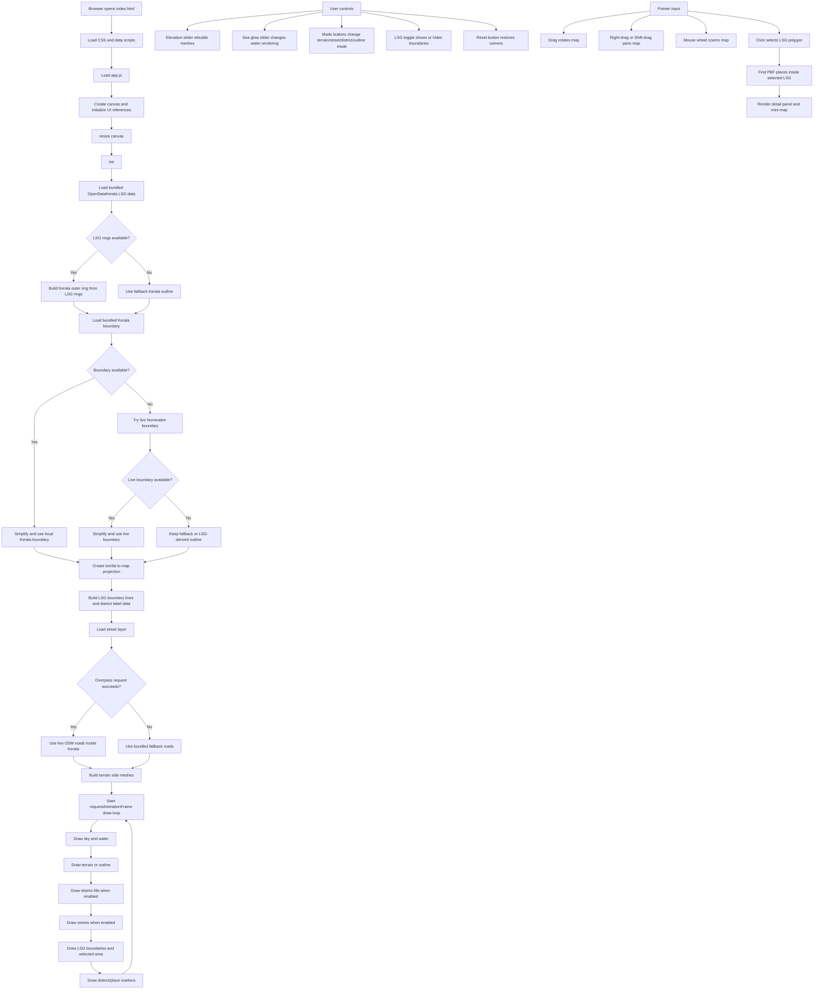

# Kerala 3D OpenStreetMap View

An interactive browser-based 3D-style map of Kerala, India, built from OpenStreetMap-derived data and OpenDataKerala local self-government boundaries. The application renders directly to an HTML canvas, so it can run as a lightweight static web app without a build step.

The map includes Kerala terrain extrusion, LSG boundary overlays, district coloring, road layers, named place markers from a local `.pbf` extraction, and a detail panel for selected local bodies.

## Features

- Canvas-rendered pseudo-3D Kerala map with drag, zoom, and pan controls.
- Bundled Kerala boundary, LSG boundary, and named-place datasets for offline-friendly startup.
- Optional live OpenStreetMap street loading through the Overpass API.
- Map modes for terrain, streets, districts, and outline views.
- Elevation and sea glow controls.
- Clickable LSG areas with district, local body, code, block, and named-place summaries.
- Node.js data extraction script for converting `kerala.pbf` named nodes into browser-ready JavaScript.

## Project Structure

| File | Purpose |
| --- | --- |
| `index.html` | Static application shell and control panel markup. |
| `styles.css` | Full-screen map UI styling, responsive controls, and detail panel styling. |
| `app.js` | Main rendering, data loading, projection, interaction, and detail-panel logic. |
| `extract-pbf-places.js` | Node.js script that reads `kerala.pbf` and generates `kerala_pbf_places.js`. |
| `kerala_lsg_data.geojson` | Local self-government boundary source data. |
| `kerala_lsg_data.js` | Browser-loadable wrapper for LSG GeoJSON data. |
| `kerala-boundary-nominatim.geojson` | Kerala boundary source data from Nominatim-style GeoJSON. |
| `kerala-boundary-nominatim.js` | Browser-loadable wrapper for Kerala boundary data. |
| `kerala.pbf` | OpenStreetMap PBF extract for Kerala. |
| `kerala_pbf_places.js` | Generated named-place payload used by the detail panel and markers. |

## Running Locally

Because the app uses `fetch` for live API requests and loads large local script files, serve the folder with a local static server instead of opening `index.html` directly.

Using Python:

```bash
python -m http.server 8080
```

Then open:

```text
http://localhost:8080
```

Using Node.js:

```bash
npx serve .
```

The bundled data lets the map render even if live OSM requests fail or the browser is offline. Live street loading requires network access to `https://overpass-api.de/api/interpreter`.

## Data Preparation

The checked-in `kerala_pbf_places.js` file is generated from `kerala.pbf`.

To regenerate it after replacing or updating the PBF extract:

```bash
node extract-pbf-places.js
```

The extractor:

1. Reads the binary `kerala.pbf` file.
2. Parses OSM primitive blocks and dense nodes.
3. Keeps named nodes with useful place-like tags such as `place`, `amenity`, `tourism`, `shop`, `office`, or `public_transport`.
4. Filters points to Kerala's approximate bounding box.
5. Writes the result to `kerala_pbf_places.js` as `window.KERALA_PBF_PLACES`.

## Application Flow Graph



## Runtime Flow

1. `index.html` loads the bundled data globals before `app.js`.
2. `app.js` creates the canvas, initializes view state, and calls `init()`.
3. `init()` loads LSG data, resolves the best available Kerala outline, creates the projection, builds boundary and district datasets, loads streets, builds terrain meshes, and starts the animation loop.
4. Each animation frame redraws the background, water, map surface, active overlays, selected LSG highlight, and labels.
5. Pointer and control events update shared view state, so the next animation frame reflects the new camera, mode, or selection.

## Data Sources and Attribution

- Local self-government boundaries: OpenDataKerala data bundled in this project.
- Base map, roads, and PBF extract: OpenStreetMap contributors.
- Live street fallback: Overpass API.
- Boundary source file: Nominatim-style GeoJSON boundary export.

OpenStreetMap data is subject to the OpenStreetMap copyright and license terms: `https://www.openstreetmap.org/copyright`.
